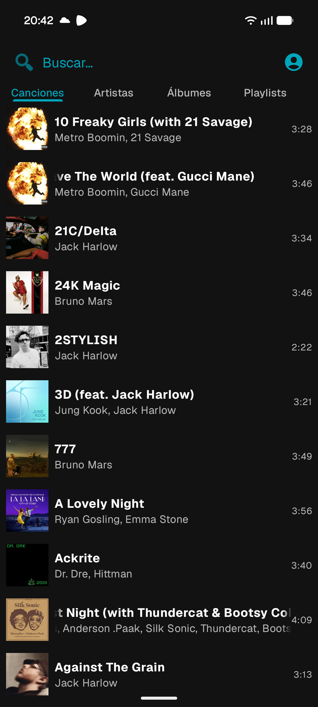
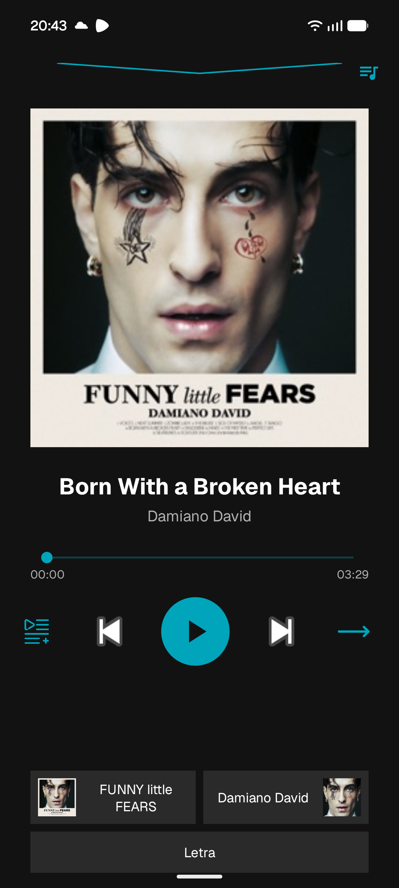
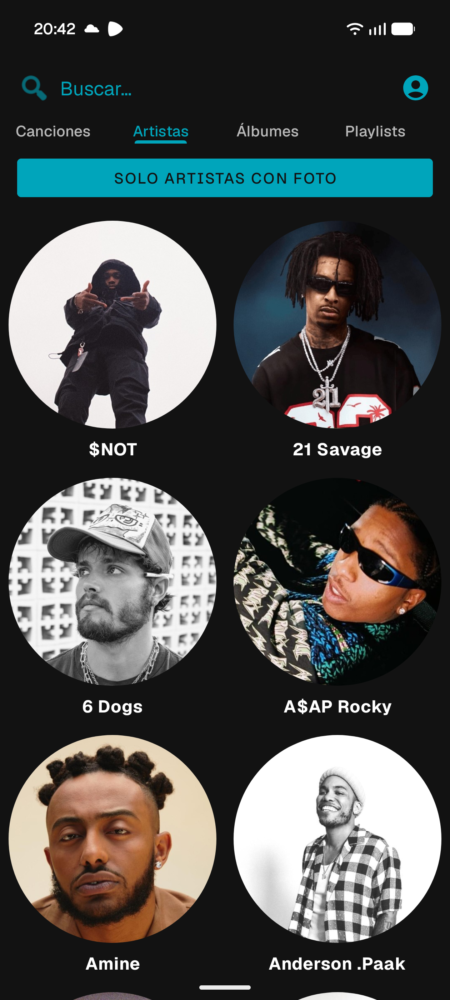
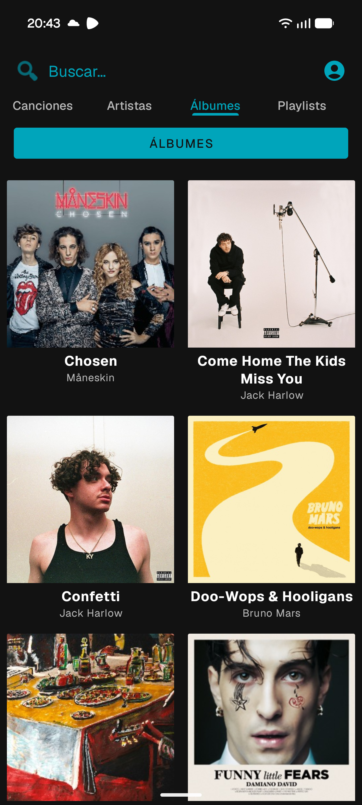

# Zepyfy

Reproductor de música para Android que reproduce tu propia biblioteca desde **Firebase**: los archivos de audio y las portadas se guardan en Cloud Storage y el catálogo (canciones, álbumes, artistas y playlists) en Cloud Firestore.

Cada persona conecta la app a **su propio proyecto de Firebase**, así que tu música y tus datos son solo tuyos. El repositorio incluye además unos **scripts en Python** que preparan tus MP3 y los suben a Firebase automáticamente.

<p align="center">
  
  
  
  
</p>

## Funcionalidades

- **Biblioteca** por canciones, artistas, álbumes (separando álbumes y sencillos) y playlists, con búsqueda por título o artista.
- **Reproducción en segundo plano** con controles en la notificación y en la pantalla de bloqueo (Media3).
- **Reproductor completo**: gestos para cambiar de canción, repetir una o todas, aleatorio, letras y acceso directo al álbum y al artista.
- **Cola de reproducción**: ver la cola, saltar a una canción, reordenar arrastrando, quitar deslizando y "reproducir a continuación".
- **Aleatorio inteligente**: al activarlo se mantiene la canción actual y "reproducir a continuación" se respeta también en modo aleatorio.
- **Playlists**: crear, renombrar, cambiar portada, borrar, añadir o quitar canciones (sin duplicados) y reordenar arrastrando.
- **Recuerda la sesión**: la cola, la canción y el segundo exactos se restauran aunque Android cierre la app.
- **Sin conexión**: los álbumes se pueden descargar para escucharlos sin red; además, todo lo que suena se guarda en una caché de 512 MB.
- **Inicio de sesión con Google** y reglas de seguridad que limitan el acceso a las cuentas autorizadas. Al cerrar sesión se borran del dispositivo el catálogo, la cola guardada y las descargas.
- **Subida automática** de la biblioteca con los scripts de `tools/`: letras, portadas y fotos de artistas incluidas.

## Tecnologías

| | |
|---|---|
| Lenguaje | Kotlin (app) y Python (scripts) |
| Interfaz | Views + ViewBinding, Material 3, Navigation (Safe Args) |
| Reproducción | AndroidX Media3 (ExoPlayer, MediaSession, descargas y caché) |
| Backend | Firebase Firestore, Cloud Storage y Authentication |
| Inicio de sesión | Credential Manager + Sign in with Google |
| Concurrencia | Corrutinas y Flow |
| Imágenes | Glide |
| Scripts | firebase-admin, mutagen, lyricsgenius, Pillow |

## Estructura del repositorio

```
├── app/                       App Android
│   └── src/main/java/com/example/zepyfyv2/
│       ├── data/              Modelos y acceso a Firestore
│       │   ├── MusicCatalog.kt        Catálogo compartido: un listener por colección, ligado a la sesión
│       │   └── PlaylistRepository.kt  Escrituras en playlists (transacciones, sin duplicados)
│       ├── media/             Reproducción
│       │   ├── MediaItems.kt          Song → MediaItem
│       │   ├── QueueStore.kt          Guarda y restaura la cola
│       │   └── SmartShuffleOrder.kt   Orden aleatorio personalizado
│       ├── download/          Descargas sin conexión (DownloadManager + DownloadService)
│       ├── auth/              Inicio de sesión y limpieza de datos al cerrar sesión
│       ├── adapters/          Adapters de RecyclerView (DiffUtil, arrastre, selección múltiple)
│       ├── PlaybackService.kt MediaSessionService con ExoPlayer
│       ├── AudioCache.kt      Caché de reproducción (LRU) + caché de descargas
│       └── *Fragment.kt / *Activity.kt   Pantallas
├── firebase/                  Reglas de seguridad de Firestore y Storage
└── tools/                     Scripts para preparar y subir la biblioteca
```

### Decisiones de diseño

- **Un único catálogo compartido.** Todas las pantallas observan el mismo `StateFlow` por colección. Firestore sirve primero su caché local (la lista aparece al instante) y después solo envía los documentos que cambian, lo que reduce mucho las lecturas.
- **El reproductor vive en un servicio.** La interfaz se conecta mediante `MediaController` y se vuelve a enganchar al controlador nuevo cada vez que la app vuelve de segundo plano.
- **Dos cachés de audio.** Descargas (nunca se vacía sola) → caché de reproducción (LRU) → red. La clave de cada archivo es el id de la canción, no la URL.
- **La seguridad está en las reglas de Firebase**, no en ocultar la configuración: `google-services.json` va dentro del APK por diseño.

## Puesta en marcha

> Todo el proyecto está dentro de la carpeta `Zepyfy/`: ábrela en Android Studio (no la raíz del repositorio) y ejecuta los comandos desde ella (`cd Zepyfy`).

Requisitos: Android Studio, **JDK 17–21** y un móvil con **Android 13 (API 33)** o superior. Para los scripts, **Python 3.9** o superior.

### 1. Crear el proyecto de Firebase

1. En [Firebase Console](https://console.firebase.google.com/) crea un proyecto.
2. Añade una **app Android** con el nombre de paquete `com.example.zepyfyv2`.
3. Activa **Firestore Database**, **Storage** y **Authentication → Sign-in method → Google**.
4. Añade la **huella SHA-1** de tu clave de depuración en la configuración de la app Android. Puedes obtenerla desde la carpeta del proyecto con:
   ```bash
   ./gradlew signingReport        # Windows: gradlew signingReport
   ```
5. Descarga `google-services.json` y colócalo en `app/` (tienes la estructura de ejemplo en `app/google-services.json.example`).

### 2. Compilar e iniciar sesión

Abre el proyecto en Android Studio, compila e inicia sesión con tu cuenta de Google. Copia tu **UID** desde el botón de cuenta de la pantalla principal (o desde Firebase Console → Authentication → Users).

### 3. Publicar las reglas de seguridad

En `firebase/firestore.rules` y `firebase/storage.rules` sustituye `PegaAquiTuUID` por tu UID y publícalas en Firebase Console (Firestore → Reglas y Storage → Reglas). Para dar acceso a otras cuentas, añade sus UID a la lista: `['uid1', 'uid2']`.

Iniciar sesión por sí solo no da acceso: son estas reglas las que impiden que otras cuentas lean o modifiquen tu biblioteca.

### 4. Añadir música con los scripts

Los scripts de `tools/` leen las etiquetas ID3 (título, artista y álbum) de tus MP3, descargan lo que falta y lo suben todo a Firebase con el formato que usa la app.

**Configuración (solo la primera vez)**

1. Instala las dependencias:
   ```bash
   pip install -r tools/requirements.txt
   ```
2. Copia `tools/config.example.ini` como `tools/config.ini` y rellena:
   - `library_dir`: la carpeta de tu biblioteca.
   - `genius_token`: un token de la API de Genius, que se crea en [genius.com/api-clients](https://genius.com/api-clients).
   - `service_account_key`: la ruta a la clave de servicio de Firebase (Firebase Console → Configuración del proyecto → Cuentas de servicio → *Generar nueva clave privada*).
   - `storage_bucket`: opcional; si lo dejas vacío se usa el bucket predeterminado del proyecto.

> **La clave de servicio da acceso total a tu proyecto de Firebase y se salta las reglas de seguridad.** Guárdala fuera del repositorio y no la compartas nunca. `config.ini` y las claves de servicio están en `.gitignore`.

**Uso**

1. Coloca tus MP3, con sus etiquetas ID3 rellenas, en la subcarpeta `Cancion` de tu biblioteca:
   ```
   Biblioteca/
   └── Cancion/
       ├── cancion1.mp3
       └── cancion2.mp3
   ```
2. Renombra las canciones y descarga letras, portadas y fotos de artistas desde Genius:
   ```bash
   python tools/renamer_and_downloader.py
   ```
   Las canciones pasan a llamarse `Título (Artista).mp3` y se crean las carpetas `Letras/` (`.txt`), `Portadas/` y `Artistas/` (`.jpg`). Lo que ya existe no se vuelve a descargar.
3. Sube todo a Firebase:
   ```bash
   python tools/auto_uploader.py
   ```
   El script pregunta si las canciones forman parte de una playlist (y su nombre). Después sube los archivos a Storage y crea en Firestore los artistas, álbumes, canciones y la playlist, enlazados entre sí. Las canciones que ya existen (mismo título y álbum) no se duplican, así que puedes volver a ejecutarlo al añadir música nueva.

Las letras se obtienen de Genius y están protegidas por derechos de autor: los scripts están pensados para uso personal, con tu propia música.

## Modelo de datos (Firestore)

Los scripts lo crean automáticamente; esto es lo que espera la app si prefieres añadir datos a mano.

**`canciones`**

| Campo | Tipo | Descripción |
|---|---|---|
| `titulo` | string | Título de la canción |
| `duracion` | number | Duración en segundos |
| `url_cancion` | string | URL de descarga del audio |
| `url_portada` | string | URL de la portada |
| `url_letra` | string | URL de un archivo de texto con la letra (opcional) |
| `album` | string | Id del documento del álbum |
| `album_nombre` | string | Nombre del álbum |
| `artistas` | array\<string\> | Ids de los documentos de artistas |
| `artistas_nombres` | array\<string\> | Nombres de los artistas (mismo orden) |

**`albums`**: `titulo` (string), `url_portada` (string), `artistas_principales` (array\<string\>, nombres).

**`artistas`**: `nombre` (string), `url_fotoartista` (string, opcional).

**`Playlist`**: `name` (string), `coverImageUrl` (string, opcional), `canciones` (array\<string\>, ids de canciones en orden).

Carpetas de Cloud Storage: `canciones/`, `portadas/`, `letras/` y `fotosArtistas/` (las crean los scripts) y `portadasPlaylist/` (la crea la app al cambiar la portada de una playlist).
